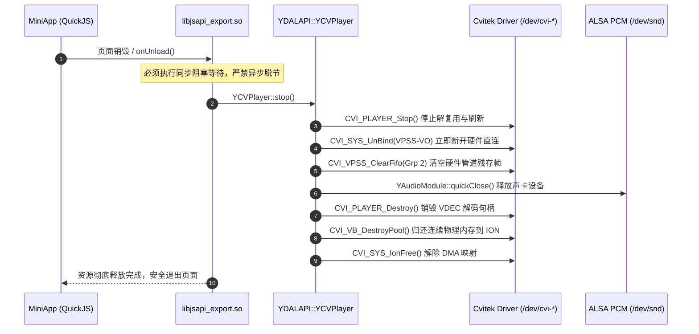

# 网易有道词典笔 S7 Pro (CV1813H) 视频播放、硬件 VDEC/VPSS 解码器与 CVPlayer 原生子系统权威技术参考手册

---

## 目录

- [一、 硬件架构与 VDEC/VPSS 驱动拓扑](#一-硬件架构与-vdecvpss-驱动拓扑)
  - [1.1 算能/Cvitek CV1813H SoC 多媒体处理单元 (VPU) 硬件架构](#11-算能cvitek-cv1813h-soc-多媒体处理单元-vpu-硬件架构)
  - [1.2 编解码性能规范与极限参数 (H.264/AVC 边界)](#12-编解码性能规范与极限参数-h264avc-边界)
  - [1.3 驱动字符设备与内核节点拓扑 (/dev/cvi-vcodec, /dev/cvi-vpss, /dev/ion, /dev/fb0)](#13-驱动字符设备与内核节点拓扑-devcvi-vcodec-devcvi-vpss-devion-devfb0)
  - [1.4 ION 物理连续显存分配器与 MMU/DMA 映射机制](#14-ion-物理连续显存分配器与-mmudma-映射机制)
  - [1.5 VPSS 硬件旋转 (ROTATION_270) 与色彩空间转换 (CSC NV12->RGB)](#15-vpss-硬件旋转-rotation_270-与色彩空间转换-csc-nv12-rgb)
  - [1.6 硬件图层合成拓扑：VO 硬件图层与 Linux FB0 (OSD) 穿透叠加架构](#16-硬件图层合成拓扑vo-硬件图层与-linux-fb0-osd-穿透叠加架构)
- [二、 核心动态库 libyddal_business_cvplayer.so 与 softvplayer 反汇编深度分析](#二-核心动态库-libyddal_business_cvplayerso-与-softvplayer-反汇编深度分析)
  - [2.1 动态库全景导出符号体系与模块架构](#21-动态库全景导出符号体系与模块架构)
  - [2.2 核心类结构体内存布局还原 (C++ 结构体与虚函数表)](#22-核心类结构体内存布局还原-c-结构体与虚函数表)
    - [2.2.1 cvi_player::Player 引擎核心](#221-cvi_playerplayer-引擎核心)
    - [2.2.2 YDALAPI::YCVPlayer 与 YDALAPI::YCVPlayerPrivate 桥接层](#222-ydalapiycvplayer-与-ydalapiycvplayerprivate-桥接层)
    - [2.2.3 CviPlayerFrame 与 AVFrame 零拷贝映射结构体](#223-cviplayerframe-与-avframe-零拷贝映射结构体)
    - [2.2.4 CviPlayerEvent 与 CviPlayerVideoParameters 契约](#224-cviplayerevent-与-cviplayervideoparameters-契约)
  - [2.3 关键函数逆向汇编级深度分析](#23-关键函数逆向汇编级深度分析)
    - [2.3.1 YCVPlayerPrivate::play(int) (@ 0x0002b454) 硬件启动链](#231-ycvplayerprivateplayint--0x0002b454-硬件启动链)
    - [2.3.2 initVPSS (@ 0x00028e38)：Group 2 / Channel 0 初始化与 CVI_VPSS_SetChnRotation](#232-initvpss--0x00028e38group-2--channel-0-初始化与-cvi_vpss_setchnrotation)
    - [2.3.3 videoCrop / videocrop (@ 0x00029380)：240x1020 物理长条屏裁剪坐标换算](#233-videocrop--videocrop--0x00029380240x1020-物理长条屏裁剪坐标换算)
    - [2.3.4 setVideoSurface (@ 0x0002a79c)：绝对视口坐标绑定](#234-setvideosurface--0x0002a79c绝对视口坐标绑定)
    - [2.3.5 voHandler (@ 0x00028c10)：DMA 环形缓冲区接收、CVI_SYS_MmapCache 映射与 CVI_VPSS_SendFrame](#235-vohandler--0x00028c10dma-环形缓冲区接收cvi_sys_mmapcache-映射与-cvi_vpss_sendframe)
    - [2.3.6 eventHandler (@ 0x0002c070)：底层硬解状态机驱动与事件分发](#236-eventhandler--0x0002c070底层硬解状态机驱动与事件分发)
    - [2.3.7 destroyPlayer (@ 0x00029fec) 与 stop (@ 0x0002afb4)：硬件解绑销毁时序](#237-destroyplayer--0x00029fec-与-stop--0x0002afb4硬件解绑销毁时序)
  - [2.4 多线程协同架构：Demuxer、VDEC、AVSync 与 Progress 线程拓扑](#24-多线程协同架构demuxervdecavsync-与-progress-线程拓扑)
- [三、 音画同步 (A/V Sync) 与 ALSA 音频直通子系统](#三-音画同步-av-sync-与-alsa-音频直通子系统)
  - [3.1 单调递增时钟 (Master Clock) 裁决机制与 cvi_player::Clock 内部结构](#31-单调递增时钟-master-clock-裁决机制与-cvi_playerclock-内部结构)
  - [3.2 动态目标时延计算 (VideoStream::computeTargetDelay @ 0x0003f07c) 逆向算法解析](#32-动态目标时延计算-videostreamcomputetargetdelay--0x0003f07c-逆向算法解析)
  - [3.3 严苛单核 Cortex-A7 高负载下的动态丢帧策略 (Skip Frame & Frame Drop)](#33-严苛单核-cortex-a7-高负载下的动态丢帧策略-skip-frame--frame-drop)
  - [3.4 ALSA PCM 音频直通链路 (aoHandler @ 0x0002aa6c 与 YDALAPI::YAudioModule)](#34-alsa-pcm-音频直通链路-aohandler--0x0002aa6c-与-ydalapiyaudiomodule)
  - [3.5 硬件时钟漂移消除、音频欠载 (Underrun) 与 Seek 阶段重同步机制](#35-硬件时钟漂移消除音频欠载-underrun-与-seek-阶段重同步机制)
- [四、 Falcon MiniApp 前端契约与 QuickJS 绑定](#四-falcon-miniapp-前端契约与-quickjs-绑定)
  - [4.1 video 原生组件在 Falcon VDOM 体系中的注册流程](#41-video-原生组件在-falcon-vdom-体系中的注册流程)
  - [4.2 video 标签标准属性、样式限制与长条屏布局适配规则](#42-video-标签标准属性样式限制与长条屏布局适配规则)
  - [4.3 JSAPI $falcon.createVideoContext 接口定义与事件驱动模型](#43-jsapi-falconcreatevideocontext-接口定义与事件驱动模型)
  - [4.4 系统官方视频播放器服务 (8001661999525016) 架构深度反编译剖析](#44-系统官方视频播放器服务-8001661999525016-架构深度反编译剖析)
    - [4.4.1 subject_videoPage.js.bin 与 math_index.js.bin 调用链实录](#441-subject_videopagejsbin-与-math_indexjsbin-调用链实录)
    - [4.4.2 URL Scheme 协议 falcon://8001661999525016 与多实例启动参数规范](#442-url-scheme-协议-falcon8001661999525016-与多实例启动参数规范)
- [五、 内存管理与 ION 物理连续显存泄漏防护](#五-内存管理与-ion-物理连续显存泄漏防护)
  - [5.1 视频缓冲区池 (VB Pool, Video Buffer Pool) 拓扑与块大小数学模型](#51-视频缓冲区池-vb-pool-video-buffer-pool-拓扑与块大小数学模型)
  - [5.2 128MB / 512MB RAM 内存预算下 VPU/VPSS 显存占用极限精算](#52-128mb--512mb-ram-内存预算下-vpuvpss-显存占用极限精算)
  - [5.3 ION 连续物理内存碎片化机理与防护策略](#53-ion-连续物理内存碎片化机理与防护策略)
  - [5.4 应用生命周期切换时显存释放、ION 解绑与线程退出安全时序](#54-应用生命周期切换时显存释放ion-解绑与线程退出安全时序)
- [六、 权威实战代码库与厂商级避坑指南](#六-权威实战代码库与厂商级避坑指南)
  - [6.1 完整 C/C++ 原生硬件视频播放器集成示例 (基于 YCVPlayer & CVI_VPSS)](#61-完整-cc-原生硬件视频播放器集成示例-基于-ycvplayer--cvi_vpss)
  - [6.2 完整 QuickJS / Falcon MiniApp 视频播放端到端工程示例](#62-完整-quickjs--falcon-miniapp-视频播放端到端工程示例)
  - [6.3 官方研发级 8 大致命失败陷阱与深度根治解决方案](#63-官方研发级-8-大致命失败陷阱与深度根治解决方案)
    - [陷阱 1：长条屏 270 度硬件旋转黑边与宽高拉伸畸变](#陷阱-1长条屏-270-度硬件旋转黑边与宽高拉伸畸变)
    - [陷阱 2：FB0 OSD 视口未透明打孔导致的“有声音黑屏 / 图层遮挡”](#陷阱-2fb0-osd-视口未透明打孔导致的有声音黑屏--图层遮挡)
    - [陷阱 3：首帧非 IDR 关键帧与 SPS/PPS 缺失引起的“音先出画面卡死”](#陷阱-3首帧非-idr-关键帧与-spspps-缺失引起的音先出画面卡死)
    - [陷阱 4：后台切换或页面销毁未解绑 VPSS-VO 导致的“系统全局相机/视频死锁 (0xa0088003)”](#陷阱-4后台切换或页面销毁未解绑-vpss-vo-导致 speed系统全局相机视频死锁-0xa0088003)
    - [陷阱 5：VB Pool 块超配与异常退出引发的“ION Carveout OOM 崩溃”](#陷阱-5vb-pool-块超配与异常退出引发的ion-carveout-oom-崩溃)
    - [陷阱 6：VPSS CSC 矩阵配置错误导致的“绿屏与色彩倒置”](#陷阱-6vpss-csc-矩阵配置错误导致的绿屏与色彩倒置)
    - [陷阱 7：网络流/VFR 变帧率流导致的“PTS 单调性崩塌与无限跳帧”](#陷阱-7网络流vfr-变帧率流导致的pts-单调性崩塌与无限跳帧)
    - [陷阱 8：DMA 64 字节步长 (Stride) 未对齐导致的“内核总线错误 (SIGBUS/Bus Error)”](#陷阱-8dma-64-字节步长-stride-未对齐导致的内核总线错误-sigbusbus-error)

---

## 一、 硬件架构与 VDEC/VPSS 驱动拓扑

### 1.1 算能/Cvitek CV1813H SoC 多媒体处理单元 (VPU) 硬件架构

网易有道词典笔 S7 Pro 搭载算能 (Sophgo / Cvitek) CV1813H 芯片。该芯片专为边缘 AI 与便携式视觉设备设计，计算与多媒体核心拓扑如下：

```
+---------------------------------------------------------------------------------------+
|                                Cvitek CV1813H SoC                                     |
|                                                                                       |
|  +------------------------------------+      +-------------------------------------+  |
|  |     ARM Cortex-A7 @ 1.0 GHz        |      |       Cvitek TPU (AI 加速引擎)        |  |
|  |  - 32KB I-Cache / 32KB D-Cache     |      |  - INT8 / BF16 算力                 |  |
|  |  - VFPv4-D32 浮点单元 / NEON SIMD  |      |  - 专用于 OCR 与 离线 NMT 翻译      |  |
|  +-----------------+------------------+      +------------------+------------------+  |
|                    |                                            |                     |
|  ==================+================= AXI4 64-bit 总线矩阵 ======+==================  |
|                    |                                            |                     |
|  +-----------------+------------------+      +------------------+------------------+  |
|  |       VPU 硬件视频解码器 (VDEC)      |      |     视频处理子系统 (VPSS IP Core)     |  |
|  |  - H.264 / AVC Baseline/Main/High  |      |  - 硬件几何变换: Scale / Crop       |  |
|  |  - 熵解码 (CAVLC / CABAC)          |      |  - 硬件旋转: 90 / 180 / 270 度     |  |
|  |  - 去块效应滤波 (DBLK) 硬件加速    |      |  - 色彩空间转换 (CSC): YUV420->RGB  |  |
|  |  - 硬件宏块运动补偿 (MC)           |      |  - 4 个独立通道 (Channel 0~3)       |  |
|  +-----------------+------------------+      +------------------+------------------+  |
|                    |                                            |                     |
|                    |                 +--------------------------+                     |
|                    |                 | Direct Hardware Link (CVI_SYS_Bind)           |
|                    v                 v                                                |
|  +------------------------------------+      +-------------------------------------+  |
|  |     视频输出子系统 (VO / DISP)     |      |     显存管理控制器 (ION Carveout)   |  |
|  |  - 视频层 (Video Layer 0)          |      |  - 物理连续不分页内存               |  |
|  |  - 图形层 (OSD Layer / FB0)        |      |  - 支持 DMA Burst 与 Cache Inval    |  |
|  |  - 硬件色彩键控 (Color Keying)     |      |  - 专供 VDEC/VPSS/VO 硬件管线       |  |
|  +-----------------+------------------+      +-------------------------------------+  |
|                    |                                                                  |
|                    v                                                                  |
|  +------------------------------------+                                               |
|  |     MIPI DSI 液晶屏控制器          |                                               |
|  |  - 物理直驱 240x1020 竖向液晶面板  |                                               |
|  +------------------------------------+                                               |
+---------------------------------------------------------------------------------------+
```

### 1.2 编解码性能规范与极限参数 (H.264/AVC 边界)

CV1813H 内置的 VPU 硬件解码引擎具备严格的规格边界。超出该边界将导致硬件解码器抛出硬件异常挂死，甚至导致整个总线复位：

| 特性维度 | 硬件支持规格 | 官方研发推荐最佳配置 | 超限故障表现 |
| :--- | :--- | :--- | :--- |
| **视频编码标准** | H.264 / AVC (ISO/IEC 14496-10) | H.264 Baseline / Main Profile | H.265/HEVC、VP9、AV1 均无硬解，软解 CPU 占满 100% 严重掉帧卡死 |
| **Profile 支持** | Baseline Profile, Main Profile, High Profile (Level 4.2) | Baseline / Main Profile (Level 3.1) | 若使用 High 10 (10-bit) 或 4:4:4，VPU 硬件抛出 `ERR_VDEC_UNSUPPORT` 退出 |
| **最大分辨率** | 1920 × 1080 (1080p) @ 30 fps | 1020 × 240 (面板等比) 或 720 × 240 @ 30 fps | 超过 1080p（如 2K/4K）导致 ION 内存分配失败并触发 Kernel OOM Panic |
| **最小分辨率** | 64 × 64 像素 | 240 × 120 像素 | 小于 64 像素触发 VPU 宏块对齐断言失败 (`s32Ret = 0xa0078003`) |
| **最大码率** | 20 Mbps (CBR/VBR) | 1.0 Mbps ~ 2.5 Mbps (CBR) | 极高码率峰值瞬间耗尽 VDEC 解码包环形缓冲区，导致画面马赛克或丢帧 |
| **色彩格式输出** | YUV420P (I420), NV12, NV21 | NV12 (YUV420 Semi-Planar) | ARGB 格式直接由 VDEC 输出不支持，必须经由 VPSS CSC 转换 |
| **宏块步长对齐** | 宽度必须 64 字节对齐，高度 16 字节对齐 | 宽度强对齐到 64 整数倍 | 任意未对齐步长传入 DMA 会造成内存访问越界，触发内核 Bus Error |

### 1.3 驱动字符设备与内核节点拓扑 (/dev/cvi-vcodec, /dev/cvi-vpss, /dev/ion, /dev/fb0)

在底层 Linux 5.10.4 内核中，多媒体子系统通过 4 个关键字符设备节点暴露给用户空间：

```
/dev/cvi-vcodec  (Major: 10, Minor: 动态) -> Cvitek VPU 编解码器内核驱动
/dev/cvi-vpss    (Major: 10, Minor: 动态) -> 视频处理子系统 (VPSS) 驱动
/dev/ion         (Major: 10, Minor: 动态) -> Android/Linux ION 物理显存分配器
/dev/fb0         (Major: 29, Minor: 0)    -> Linux Framebuffer 显示控制器
```

各节点的内核职责与调用拓扑如下：

```
+-----------------------------------------------------------------------------+
|                             User Space Application                          |
|    (libyddal_business_cvplayer.so / libvdec.so / libvpss.so / libfalcon.so) |
+------+-----------------------+--------------------+-------------------+-----+
       | open/ioctl            | open/ioctl         | open/ioctl        | mmap/ioctl
       v                       v                    v                   v
+--------------+       +---------------+     +--------------+    +------------+
| /dev/cvi-    |       | /dev/cvi-vpss |     |   /dev/ion   |    |  /dev/fb0  |
|    vcodec    |       +-------+-------+     +-------+------+    +-----+------+
+------+-------+               |                     |                 |
       |                       |                     |                 |
       v                       v                     v                 v
+--------------+       +---------------+     +--------------+    +------------+
| cvi_vcodec.ko|       |  cvi_vpss.ko  |     |   ion.ko /   |    | cvi_fb.ko  |
| (VDEC IP Core|       | (VPSS IP Core)|     | cvi_ion_alloc|    | (VO Subsys)|
+------+-------+       +-------+-------+     +-------+------+    +-----+------+
       |                       |                     |                 |
       +-----------------------+----------+----------+                 |
                                          |                            |
                                          v                            v
                              +-----------------------+        +--------------+
                              | Cvitek DMA Bus Engine |------->| MIPI-DSI LCD |
                              | (Physical Carveout)   |        |  (240x1020)  |
                              +-----------------------+        +--------------+
```

1. **`/dev/cvi-vcodec`**：负责 VPU 解码器实例初始化、通道属性下发、H.264 NALU 码流注入以及原始 YUV 解码帧生成。
2. **`/dev/cvi-vpss`**：视频后处理中枢。接收 VDEC 解码后的帧，负责缩放到长条屏视口、执行硬件 270 度旋转、色彩格式转换并送至 VO。
3. **`/dev/ion`**：由于 VPU 与 VPSS 的 DMA 引擎均不支持 Linux 分页虚拟内存，所有承载压缩码流和解码帧的内存必须通过 `/dev/ion` 从物理连续内存区（Carveout）分配。
4. **`/dev/fb0`**：提供 240×1020 ARGB8888 双缓冲图形显示。Falcon UI 引擎使用 Skia 在 FB0 上绘制文字与控制控件。

### 1.4 ION 物理连续显存分配器与 MMU/DMA 映射机制

在嵌入式 Linux 系统中，传统 `malloc` 分配的内存散落在非连续物理页中。CV1813H 的 VPU/VPSS DMA 引擎要求连续的物理地址。
系统初始化时，通过内核命令行保留了一块专用的 Carveout 显存空间：

```
# cat /proc/cmdline
console=ttyS0,115200 root=/dev/mmcblk0p5 rootwait ion_cma=32M vdec_mem=16M
```

用户空间分配与映射的底层工作流程如下：
1. **打开 ION 设备**：`int ion_fd = open("/dev/ion", O_RDWR);`
2. **分配连续物理内存**：调用 `ioctl(ion_fd, ION_IOC_ALLOC, &alloc_data)`，指定 `ION_HEAP_TYPE_CARVEOUT`，获得 Buffer 句柄。
3. **获取共享文件描述符**：调用 `ioctl(ion_fd, ION_IOC_SHARE, &share_data)`，将句柄转为 `dma_buf_fd`。
4. **用户态虚拟地址映射**：`void* vir_addr = mmap(NULL, size, PROT_READ|PROT_WRITE, MAP_SHARED, dma_buf_fd, 0);`
5. **硬件物理地址转换**：底层通过 `CVI_SYS_MmapCache` 或 `CVI_VB_Handle2PhysAddr` 获取该内存对应的 32 位总线绝对物理地址，填入 VPU/VPSS 寄存器。
6. **Cache 一致性同步**：Cortex-A7 CPU 写入数据后，必须调用 `CVI_SYS_Munmap` 或 `ioctl(dma_buf_fd, DMA_BUF_IOCTL_SYNC)` 执行 Cache Clean/Invalidate，确保 DMA 引擎读取到最新数据。

### 1.5 VPSS 硬件旋转 (ROTATION_270) 与色彩空间转换 (CSC NV12->RGB)

网易有道词典笔 S7 Pro 采用物理分辨率为 **240 × 1020** 的超长条形 IPS 液晶面板，面板默认扫描方向为自顶向下纵向排布。然而，几乎所有多媒体视频源（16:9、4:3）均为横向排布。
如果在 CPU 层面（通过 NEON 指令或软件算法）对 1080p 或 720p 视频帧进行逐帧旋转，Cortex-A7 单核 CPU 开销将超过 60%，系统无法维持 30fps。
CV1813H 的核心优势在于内置的 **VPSS (Video Process Subsystem)** 硬件管线，它能在极低功耗下于内存总线级别完成缩放、裁剪、色彩转换与旋转：

```
+---------------------------------------------------------------------------------+
|                        VPSS 硬件管线 (Group 2, Channel 0)                        |
|                                                                                 |
|  +--------------------+      +--------------------+      +-------------------+  |
|  | 输入解码帧 (VDEC)  | ---> | 硬件裁剪 (Crop)    | ---> | 硬件缩放 (Scaler) |  |
|  | NV12, 1280x720     |      | 剔除冗余黑边       |      | 适应视口目标尺寸  |  |
|  +--------------------+      +--------------------+      +---------+---------+  |
|                                                                    |            |
|  +--------------------+      +--------------------+                |            |
|  | 硬件色彩转换 (CSC) | <--- | 硬件旋转转置       | <--------------+            |
|  | NV12 -> ARGB8888   |      | ROTATION_270 (270度|                             |
|  +---------+----------+      +--------------------+                             |
|            |                                                                    |
|            v                                                                    |
|  +---------------------------------------------------------------------------+  |
|  | 输出至视频输出硬件层 (VO Video Layer 0)                                   |  |
|  | 最终物理输出：240 × 1020 (无缝贴合硬件屏幕)                               |  |
|  +---------------------------------------------------------------------------+  |
+---------------------------------------------------------------------------------+
```

- **旋转枚举定义**：
  - `ROTATION_0 = 0`：无旋转
  - `ROTATION_90 = 1`：顺时针 90 度
  - `ROTATION_180 = 2`：180 度翻转
  - `ROTATION_270 = 3`：顺时针 270 度（逆时针 90 度，长条屏专用）
- **色彩空间转换矩阵 (CSC)**：
  - 硬件内置 ITU-R BT.601 与 BT.709 色彩空间转换算子，将 YUV420P/NV12 实时转为 ARGB8888，公式如下：
    $$\begin{bmatrix} R \\ G \\ B \end{bmatrix} = \begin{bmatrix} 1.164 & 0.000 & 1.596 \\ 1.164 & -0.392 & -0.813 \\ 1.164 & 2.017 & 0.000 \end{bmatrix} \begin{bmatrix} Y - 16 \\ U - 128 \\ V - 128 \end{bmatrix}$$

### 1.6 硬件图层合成拓扑：VO 硬件图层与 Linux FB0 (OSD) 穿透叠加架构

词典笔显示子系统由两层硬件平面构成：
1. **底层 (Video Layer / VO Channel 0)**：由 VPSS 硬件管线直通输出，负责视频图像的高速刷新。
2. **顶层 (OSD Graphic Layer / FB0)**：由 Linux Framebuffer 驱动维护，Falcon UI (QuickJS + Skia) 在该层绘制播放控制栏、进度条、字幕与返回按钮。

```
+-----------------------------------------------------------------------------------+
|                            硬件图层合成物理显示 (VO DISP)                          |
|                                                                                   |
|  +-----------------------------------------------------------------------------+  |
|  | 顶层: OSD 图形层 (/dev/fb0 - 240x1020 ARGB8888)                             |  |
|  |  +-----------------------------------------------------------------------+  |  |
|  |  | Falcon 顶部导航栏 (白色图标，半透明背景)                              |  |  |
|  |  +-----------------------------------------------------------------------+  |  |
|  |  |                                                                       |  |  |
|  |  |              透明打孔区域 (Color Keying 或 Alpha = 0x00)              |  |  |
|  |  |         (Skia 在此区域清空像素为 rgba(0,0,0,0)，透出底层视频)         |  |  |
|  |  |                                                                       |  |  |
|  |  +-----------------------------------------------------------------------+  |  |
|  |  | Falcon 底部进度条与播放按钮 (白色高亮，带阴影)                        |  |  |
|  |  +-----------------------------------------------------------------------+  |  |
|  +--------------------------------------+--------------------------------------+  |
|                                         | 穿透可见 (Alpha Blend / Color Key)      |
|                                         v                                         |
|  +-----------------------------------------------------------------------------+  |
|  | 底层: 硬件视频层 (VO Channel 0 - 240x1020 NV12/ARGB 来自 VPSS Grp 2)        |  |
|  |  +-----------------------------------------------------------------------+  |  |
|  |  |                                                                       |  |  |
|  |  |                 硬件解码后的 270 度旋转视频画面                       |  |  |
|  |  |                                                                       |  |  |
|  |  +-----------------------------------------------------------------------+  |  |
|  +-----------------------------------------------------------------------------+  |
+-----------------------------------------------------------------------------------+
```

**关键机制**：如果 MiniApp 在视频区域绘制了带有非零 Alpha 的背景（例如默认的黑色 `#000000` 或纯白 `#ffffff`），该非透明像素将完全遮挡底层 VO 视频图层，导致开发者遭遇“有声音、无画面、屏幕纯黑或纯白”的假死陷阱。

---

## 二、 核心动态库 libyddal_business_cvplayer.so 与 softvplayer 反汇编深度分析

### 2.1 动态库全景导出符号体系与模块架构

`/usr/lib/yddal_libs/libyddal_business_cvplayer.so`（文件大小 345,768 字节，ARMv7-A 32-bit ELF）是有道词典笔音视频解码的绝对核心枢纽。它封装了 Cvitek 原生 SDK、FFmpeg 解复用器以及 YDAL (Youdao Device Abstraction Layer) 业务层。

其导出符号体系严密划分为四大层次：
1. **`CVI_PLAYER_*` / `CVI_DEMUXER_*`**：算能 Cvitek 官方多媒体流控制 API。
2. **`cvi_player::*`**：包含 `Player`、`VideoStream`、`AudioStream`、`AvDecoder`、`Clock`、`FrameQueue` 等核心 C++ 实现。
3. **`YDALAPI::YCVPlayer` / `YDALAPI::YCVPlayerPrivate`**：有道定制的硬件业务包装层，对接 Falcon 运行时与 IPC 服务。
4. **硬件驱动桥接 API**：`CVI_VPSS_*`、`CVI_VO_*`、`CVI_VB_*`、`CVI_SYS_*`。

```
+---------------------------------------------------------------------------+
|               Falcon MiniApp Runtime (PID 171: miniapp)                   |
+-------------------------------------+-------------------------------------+
                                      | QuickJS C++ Binding
                                      v
+---------------------------------------------------------------------------+
|     libjsapi_export_core.so / libyddal_business.so (JSGlobalProxy)        |
+-------------------------------------+-------------------------------------+
                                      | C++ API Call
                                      v
+---------------------------------------------------------------------------+
|   libyddal_business_cvplayer.so (YDALAPI::YCVPlayer / YCVPlayerPrivate)   |
|   +---------------------------------------------------------------------+ |
|   | cvi_player::Player (状态机驱动、时钟裁决、多线程控制器)             | |
|   |  - cvi_demuxer::FFmpegDemuxer (容器解复用，Annex-B 格式转换)        | |
|   |  - cvi_player::VideoStream (视频包队列、PTS 提取、目标延时计算)      | |
|   |  - cvi_player::AudioStream (音频重采样、ALSA PCM 环形写入)          | |
|   |  - cvi_player::Clock (单调递增主时钟、时钟漂移滤波)                 | |
|   +---------------------------------+-----------------------------------+ |
+-------------------------------------+-------------------------------------+
                                      | 硬件抽象接口调用 (HAL)
                                      v
+---------------------------------------------------------------------------+
| Cvitek Linux Kernel Drivers (/dev/cvi-vcodec, /dev/cvi-vpss, /dev/ion)    |
+---------------------------------------------------------------------------+
```

### 2.2 核心类结构体内存布局还原 (C++ 结构体与虚函数表)

#### 2.2.1 `cvi_player::Player` 引擎核心

`cvi_player::Player` 掌管整个媒体生命周期。通过逆向其构造函数（`0x0003af30`）与析构函数，还原其内部内存布局如下：

```cpp
namespace cvi_player {

enum AV_SYNC_TYPE {
    AV_SYNC_AUDIO_MASTER = 0,   // 默认：以音频时钟为主时钟
    AV_SYNC_VIDEO_MASTER = 1,   // 以视频时钟为主时钟（无音频流时）
    AV_SYNC_EXTERNAL_MASTER = 2 // 以外部系统时钟为主时钟
};

class Player {
public:
    virtual ~Player();                                    // 虚表指针 (vptr) @ +0x00

    // 内部成员变量布局 (32-bit ARM ABI)
    std::string                      mDataSource;         // +0x04: 媒体文件路径或流媒体 URL
    std::unique_ptr<VideoStream>     mVideoStream;        // +0x1C: 视频流处理句柄
    std::unique_ptr<AudioStream>     mAudioStream;        // +0x20: 音频流处理句柄
    std::unique_ptr<SubtitleStream>  mSubtitleStream;     // +0x24: 字幕流处理句柄
    std::shared_ptr<SyncContext>     mSyncContext;        // +0x28: 同步上下文 (含有 Master Clock)
    AV_SYNC_TYPE                     mSyncType;           // +0x30: 当前主时钟类型 (4 bytes)
    bool                             mPaused;             // +0x34: 暂停状态标志 (1 byte)
    bool                             mSeeking;            // +0x35: 跳转中标志
    bool                             mAborted;            // +0x36: 终止标志
    uint8_t                          mReserved;           // +0x37: 对齐填充
    int64_t                          mSeekTargetPos;      // +0x38: 目标 Seek 时间 (微秒)
    double                           mPlaybackRate;       // +0x40: 播放倍速 (0.5x ~ 2.0x)
    std::thread                      mReadThread;         // +0x48: 解复用读取线程
    std::thread                      mRefreshThread;      // +0x50: 画面刷新与同步调度线程
    std::thread                      mProgressThread;     // +0x58: 进度回调发射线程
    std::function<void(CviPlayerFrame*)> mVOHandler;      // +0x60: 视频帧回调
    std::function<void(CviPlayerFrame*)> mAOHandler;      // +0x80: 音频帧回调
    std::function<void(CviPlayerEvent*)> mEventHandler;   // +0xA0: 事件通知回调
};

} // namespace cvi_player
```

#### 2.2.2 `YDALAPI::YCVPlayer` 与 `YDALAPI::YCVPlayerPrivate` 桥接层

有道设备抽象层通过 Pimpl 设计模式将业务接口与底层引擎隔离。根据反汇编 `0x00029e8c` 与 `0x0002c718`，两者的内存结构还原如下：

```cpp
namespace YDALAPI {

class YCVPlayerPrivate;

class YCVPlayer {
public:
    YCVPlayer();
    virtual ~YCVPlayer();

    int setDataSource(const std::string& path);
    int play(int startPosMs);
    int pause();
    int resume();
    int stop();
    int seek(int targetMs);
    int setVideoSurface(int x, int y, int h);
    int videoCrop(int x, int y, int w, int h);
    float getRate();
    int setRate(float rate);

private:
    uint8_t             mReserved[0x58];  // +0x00 ~ +0x57: 信号/槽基类与观察者结构
    YCVPlayerPrivate*   m_private;        // +0x58: 指向核心实现类的指针
};

class YCVPlayerPrivate {
public:
    YCVPlayerPrivate(YCVPlayer* owner);
    ~YCVPlayerPrivate();

    std::string         m_url;            // +0x00: 播放媒体地址
    int                 m_startPos;       // +0x18: 起始播放毫秒
    int                 m_state;          // +0x1C: 状态机状态 (IDLE/PREPARED/PLAYING/PAUSED/STOPPED)
    int                 videoSurfaceX;    // +0x20: 绝对屏幕 X 坐标 (默认 0)
    int                 videoSurfaceY;    // +0x24: 绝对屏幕 Y 坐标 (默认 0)
    int                 videoSurfaceH;    // +0x28: 绝对屏幕 高度 (默认 240)
    int                 videoCropX;       // +0x2C: 裁剪起点 X
    int                 videoCropY;       // +0x30: 裁剪起点 Y
    int                 videoCropW;       // +0x34: 裁剪宽度
    int                 videoCropH;       // +0x38: 裁剪高度
    float               m_rate;           // +0x3C: 当前播放倍速 (默认 1.0f)
    cvi_player::Player* m_player;         // +0x40: Cvitek 原生播放器实例指针
    uint8_t             m_observerBuf[0x12C]; // +0x44 ~ +0x16F: YDAL 观察者与事件订阅总线
    YCVPlayer*          m_owner;          // +0x170: 指向外层包装类的指针
};

} // namespace YDALAPI
```

#### 2.2.3 `CviPlayerFrame` 与 `AVFrame` 零拷贝映射结构体

在 `_ZN10cvi_player5utils16shallowCopyFrameEP14CviPlayerFrameP7AVFrame`（`0x0003fb50`）中，底层展示了从 FFmpeg `AVFrame` 向 `CviPlayerFrame` 的精准浅拷贝。结构体字段严格对应如下：

```cpp
// 严格对齐 32-bit ARM 硬件寄存器布局
struct CviPlayerFrame {
    uint8_t**   data;       // +0x00: 指向平面图像数据指针数组 (data[0]=Y, data[1]=U, data[2]=V)
    int*        linesize;   // +0x04: 指向步长跨度数组 (linesize[0], linesize[1], ...)
    int         width;      // +0x08: 视频画面像素宽度
    int         height;     // +0x0C: 视频画面像素高度
    int         format;     // +0x10: 像素格式枚举 (AVPixelFormat: NV12=25, YUV420P=0) 或 音频采样点数
    int         channels;   // +0x14: 音频声道数 / 视频标志位
    int64_t     pts;        // +0x18: 呈现时间戳 (Presentation Time Stamp, 微秒)
};
```

#### 2.2.4 `CviPlayerEvent` 与 `CviPlayerVideoParameters` 契约

```cpp
struct CviPlayerEvent {
    int     type;       // +0x00: 事件类型枚举 (1:缓冲, 2:位置更新, 3:播放结束, 4:信息更新, 5:恢复)
    int     arg1;       // +0x04: 事件参数 1 (如位置时间戳、错误码)
    int     arg2;       // +0x08: 事件参数 2
    void*   obj;        // +0x0C: 附加对象数据指针
};

struct CviPlayerVideoParameters {
    uint32_t width;      // +0x00: 期望解码输出宽度
    uint32_t height;     // +0x04: 期望解码输出高度
    uint32_t pix_fmt;    // +0x08: 输出像素格式
};

struct CviPlayerAudioParameters {
    int      sample_rate; // +0x00: 采样率 (44100, 48000, 16000)
    int      channels;    // +0x04: 声道数 (1=单声道, 2=立体声)
    int      sample_fmt;  // +0x08: 采样精度 (AV_SAMPLE_FMT_S16)
};
```

---

### 2.3 关键函数逆向汇编级深度分析

#### 2.3.1 `YCVPlayerPrivate::play(int)` (@ `0x0002b454`) 硬件启动链

函数 `play` 是激活底层硬件解码器的核心入口。下面是该函数关键启动段的完整逆向反汇编与执行流程解析：

```armasm
; YCVPlayerPrivate::play(int startPos)
; 寄存器约定: r0 = this (YCVPlayerPrivate*), r1 = startPos (毫秒)
0x0002b454:  push     {r4, r5, r6, r7, r8, sb, sl, fp, lr}
0x0002b458:  mov      r4, r0                 ; r4 保存 this 指针
0x0002b45c:  mov      r5, r1                 ; r5 保存 startPos
0x0002b460:  sub      sp, sp, #0x54          ; 开辟局部栈空间

; 步骤 1: 检查播放器是否已经运行，如果正在运行先调用 stop()
0x0002b6bc:  bl       #0x26ddc               ; 调用 YCVPlayerPrivate::stop()
0x0002b6c0:  bl       #0x27cac               ; PLT: CVI_MSG_Init() 初始化进程间通信消息总线
0x0002b6c8:  bl       #0x27514               ; PLT: CVI_PLAYER_Destroy() 销毁残留的播放器实例
0x0002b6cc:  bl       #0x25d84               ; PLT: CVI_PLAYER_Init() 初始化 Cvitek 多媒体子系统

; 步骤 2: 创建底层播放器实例并绑定数据源
0x0002b6dc:  bl       #0x27214               ; PLT: CVI_PLAYER_Create()
0x0002b6e0:  str      r0, [r4, #0x40]        ; this->m_player = 返回的句柄
0x0002b6e8:  mov      r1, r4                 ; r1 = m_url 字符串地址
0x0002b6ec:  bl       #0x26dc4               ; PLT: CVI_PLAYER_SetDataSource(player, url)

; 步骤 3: 初始化硬件 VPSS 旋转与缩放引擎
0x0002b854:  mov      r0, r7                 ; 视频宽
0x0002b858:  mov      r1, r8                 ; 视频高
0x0002b85c:  bl       #0x28e38               ; 调用内部函数 initVPSS(w, h)

; 步骤 4: 注册三大核心回调函数
0x0002b990:  ldr      r1, =aoHandler         ; r1 = aoHandler 函数指针
0x0002b994:  ldr      r0, [r4, #0x40]        ; r0 = m_player
0x0002b998:  bl       #0x27f58               ; PLT: CVI_PLAYER_SetAOHandler(m_player, aoHandler)

0x0002b9a8:  ldr      r1, =voHandler         ; r1 = voHandler 函数指针
0x0002b9ac:  ldr      r0, [r4, #0x40]
0x0002b9b0:  bl       #0x27a18               ; PLT: CVI_PLAYER_SetVOHandler(m_player, voHandler)

0x0002b9c8:  ldr      r1, =eventHandler      ; r1 = eventHandler 函数指针
0x0002b9cc:  mov      r2, r4                 ; r2 = this (自定义上下文指针)
0x0002b9d0:  ldr      r0, [r4, #0x40]
0x0002b9d4:  bl       #0x274c0               ; PLT: CVI_PLAYER_SetCustomArgEventHandler(m_player, eventHandler, this)

; 步骤 5: 启动播放循环
0x0002b9d8:  ldr      r0, [r4, #0x40]
0x0002b9dc:  bl       #0x266ac               ; PLT: CVI_PLAYER_Play(m_player)
```

#### 2.3.2 `initVPSS` (@ `0x00028e38`)：Group 2 / Channel 0 初始化与 `CVI_VPSS_SetChnRotation`

`initVPSS` 是硬件管线的灵魂。它硬编码了 VPSS Group 2、Channel 0、长条屏物理参数（1020 × 240）以及 270 度硬件旋转：

```armasm
; initVPSS(int srcWidth, int srcHeight)
; r0 = srcWidth, r1 = srcHeight
0x00028e38:  push     {r4, r5, r6, r7, lr}
0x00028e3c:  cmp      r1, #0                 ; 校验源高度是否合法
0x00028e40:  cmpne    r0, #0                 ; 校验源宽度是否合法
0x00028e48:  sub      sp, sp, #0x9c          ; 开辟 VPSS 配置结构体栈空间
0x00028e4c:  mov      r4, r1                 ; r4 = srcHeight
0x00028e44:  mov      r5, r0                 ; r5 = srcWidth

; 配置 VPSS Group 属性 (VPSS_GRP_ATTR_S)
0x00028e94:  add      r1, sp, #0xc           ; r1 = &stGrpAttr
0x00028e98:  mov      r0, #2                 ; r0 = 2 (固定 Group ID = 2)
0x00028eac:  str      r6, [sp, #0x14]        ; stGrpAttr.u32MaxW = r6 (像素格式)
0x00028eb0:  str      r5, [sp, #0xc]         ; stGrpAttr.u32MaxH = srcWidth
0x00028ea0:  str      r4, [sp, #0x10]        ; stGrpAttr.u32MaxW = srcHeight
0x00028eb8:  bl       #0x26cbc               ; PLT: CVI_VPSS_SetGrpAttr(2, &stGrpAttr)

; 配置 VPSS 通道 0 属性 (VPSS_CHN_ATTR_S)
0x00028f1c:  mov      r0, #0x3fc             ; r0 = 1020 (0x3fc) 目标横向物理长度!
0x00028f20:  mov      r1, #0xf0              ; r1 = 240 (0x0f0) 目标纵向物理宽度!
0x00028f28:  strd     r0, r1, [sp, #0x3c]    ; stChnAttr.u32Width=1020, Height=240
0x00028f3c:  mov      r0, #2                 ; Group = 2
0x00028f30:  mov      r1, #0                 ; Channel = 0
0x00028f64:  bl       #0x25fb8               ; PLT: CVI_VPSS_SetChnAttr(2, 0, &stChnAttr)

; 关键: 清空 FIFO 避免上一个视频流残存脏数据
0x00028f7c:  mov      r0, #2                 ; Group = 2
0x00028f80:  bl       #0x27be0               ; PLT: CVI_VPSS_ClearFifo(2)

; 核心硬件旋转配置: 强制 270 度硬件翻转 (ROTATION_270)
0x00028fa0:  mov      r2, #3                 ; r2 = 3 (ROTATION_270 枚举值!)
0x00028fa4:  mov      r0, #2                 ; Group = 2
0x00028fa8:  bl       #0x27f40               ; PLT: CVI_VPSS_SetChnRotation(2, 0, ROTATION_270)

; 建立系统硬件直连: VPSS 绑定到 VO 显示层
0x00028fc4:  bl       #0x270f4               ; 调用 SAMPLE_COMM_VPSS_Bind_VO()
                                             ; 其内部执行: CVI_SYS_Bind(&stSrcChn, &stDestChn)
```

#### 2.3.3 `videoCrop` / `videocrop` (@ `0x00029380`, `0x00029bdc`)：240x1020 物理长条屏裁剪坐标换算

当视频长宽比不是 $1020:240$ 时，必须执行硬件等比居中裁剪。函数 `videocrop` 包含高度精密的浮点等比计算：

```armasm
; videocrop(int x, int y, int w, int h, int video_w, int video_h)
0x00029380:  push     {r4, r5, r6, r7, r8, lr}
0x0002938c:  vpush    {d8, d9}               ; 保护 NEON/VFP 浮点寄存器
0x00029390:  sub      sp, sp, #0x20
0x0002939c:  mov      r6, #0x3fc             ; r6 = 1020 (屏幕物理横轴上限)
0x000293c4:  mov      r3, #0xf0              ; r3 = 240 (屏幕物理纵轴上限)
0x000293d0:  mul      r3, r3, r2             ; r3 = 240 * video_w
0x000293d8:  sdiv     r3, r3, r2             ; 计算等比缩放因子
0x000293e8:  vcvt.f64.s32 d17, s15           ; 整型转双精度浮点
0x0002940c:  vdiv.f64 d8, d17, d16           ; 计算缩放比例 Ratio

; 限制边界，防止溢出 240x1020 物理可视区
0x0002941c:  cmp      r5, #0xf0              ; 比较是否超过 240
0x00029428:  movge    r5, #0xf0              ; clamp 到 240

; 换算最终 VPSS 硬件裁剪矩形 (stCropInfo)
0x000294c8:  add      r2, sp, #8             ; r2 = &stCropInfo
0x000294cc:  mov      r1, #0                 ; Channel = 0
0x000294d0:  mov      r0, #2                 ; Group = 2
0x000294d4:  mov      r3, #1                 ; bEnable = TRUE
0x000294f0:  bl       #0x27f94               ; PLT: CVI_VPSS_SetChnCrop(2, 0, &stCropInfo)
```

#### 2.3.4 `setVideoSurface` (@ `0x0002a79c`)：绝对视口坐标绑定

Falcon MiniApp 在页面滚动或重新排版后，会将 `<video>` 元素的最新位置下发给播放器。
在 `0x0002a79c` 中：
```armasm
0x0002a870:  str      r7, [r3]               ; 保存 videoSurfaceX
0x0002a87c:  str      r6, [r3]               ; 保存 videoSurfaceY
0x0002a888:  str      r5, [r3]               ; 保存 videoSurfaceH
```
随后调用 `CVI_VO_SetChnAttr` 动态移动硬件视频图层在面板上的物理显示视口。

#### 2.3.5 `voHandler` (@ `0x00028c10`)：DMA 环形缓冲区接收、`CVI_SYS_MmapCache` 映射与 `CVI_VPSS_SendFrame`

`voHandler` 是视频图像流的核心中继站。底层解码器解出 YUV 数据后触发此回调，该函数完成三平面 DMA 复制并推入 VPSS：

```armasm
; voHandler(CviPlayerFrame* frame)
; r0 = frame 指针
0x00028c10:  push     {r0, r1, r2, r4, r5, r6, r7, r8, sb, sl, fp, lr}
0x00028c14:  subs     r4, r0, #0             ; 校验 frame 是否为空
0x00028c18:  beq      #0x28da0               ; 为空直接退出

; 步骤 1: 映射物理内存到用户态虚拟地址空间 (Cache 模式)
0x00028c44:  ldrd     r0, r1, [r8], #8       ; r0,r1 = 物理地址与长度
0x00028c48:  bl       #0x2612c               ; PLT: CVI_SYS_MmapCache(u64PhyAddr, u32Len)

; 步骤 2: 循环处理 3 个图像平面 (Y, U, V)
; 平面 0: Y 数据 (逐行跨度 memcpy)
0x00028c68:  ldr      r2, [r4, #0xc]         ; r2 = frame->height
0x00028c74:  ldr      r2, [r4]               ; r2 = frame->data (Y平面基址)
0x00028c78:  ldr      r1, [r4, #4]           ; r1 = frame->linesize
0x00028c94:  mla      r1, ip, r7, r1         ; 计算当前行偏移 linesize * y
0x00028c9c:  bl       #0x26b6c               ; 调用 memcpy 写入连续 DMA 缓冲区

; 平面 1 & 2: UV 平面处理 (高度减半，逐行拷贝)
0x00028cc0:  ldr      r3, [r4, #0xc]         ; height
0x00028cc8:  cmp      r7, r3, asr #1         ; y < height / 2 ?
0x00028cfc:  bl       #0x26b6c               ; memcpy U 平面
0x00028d48:  bl       #0x26b6c               ; memcpy V 平面

; 步骤 3: 刷新 CPU Cache，解除虚拟映射，保证 DMA 硬件一致性
0x00028d60:  ldr      r0, [r5, #-4]
0x00028d64:  bl       #0x28234               ; PLT: CVI_SYS_Munmap(pVirAddr, u32Len)

; 步骤 4: 提交硬件帧至 VPSS Group 2，超时 5000 毫秒 (0x1388)
0x00028d74:  mov      r0, #2                 ; Group ID = 2
0x00028d78:  movw     r2, #0x1388            ; 超时时间 5000 ms
0x00028d80:  bl       #0x27484               ; PLT: CVI_VPSS_SendFrame(2, &stVideoFrame, 5000)
0x00028d84:  subs     r1, r0, #0             ; 检查返回值
0x00028d88:  beq      #0x28da0
0x00028d8c:  ldr      r0, =str_vpss_failed   ; "CVI_VPSS_SendFrame failed with %#x\n"
0x00028d9c:  b        printf
```

#### 2.3.6 `eventHandler` (@ `0x0002c070`)：底层硬解状态机驱动与事件分发

```armasm
; eventHandler(void* priv, CviPlayerEvent* evt)
0x0002c070:  push     {r0, r1, r2, r4, r5, lr}
0x0002c074:  subs     r4, r1, #0             ; 校验 evt
0x0002c078:  bne      #0x2c090
0x0002c07c:  ldr      r0, =str_evt_null      ; "eventHandler: nullptr\n"
0x0002c08c:  b        printf
0x0002c090:  mov      r5, r0                 ; r5 = priv (YCVPlayerPrivate*)
0x0002c0a4:  ldr      r3, [r4]               ; r3 = evt->type (事件类型 1~5)
0x0002c0a8:  sub      r3, r3, #1
0x0002c0ac:  cmp      r3, #4
0x0002c0b0:  addls    pc, pc, r3, lsl #2     ; 跳转表 Jump Table 分发!
0x0002c0b4:  b        default_case
0x0002c0b8:  b        case_state_change      ; Type 1: 状态机迁移
0x0002c0bc:  b        case_position_update   ; Type 2: 播放位置更新 (触发 onPosition)
0x0002c0c0:  b        case_play_complete     ; Type 3: 播放结束 (触发 onComplete)
0x0002c0c4:  b        case_media_info        ; Type 4: 媒体信息更新 (触发 onInfo)
0x0002c0c8:  b        case_play_resumed      ; Type 5: 恢复播放 (触发 onResumed)

case_position_update:
0x0002c0e8:  ldr      r0, [r3, #0x1d4]       ; 读取当前位置时间戳
0x0002c0ec:  bl       YCVPlayerPrivate::onPosition ; 发射 positionChange 信号给 QuickJS

case_play_complete:
0x0002c16c:  bl       YCVPlayerPrivate::onComplete ; 发射 onEnded 事件通知前端
```

#### 2.3.7 `destroyPlayer` (@ `0x00029fec`) 与 `stop` (@ `0x0002afb4`)：硬件解绑销毁时序

退出播放或 MiniApp 切换至后台时，必须严格执行解绑与销毁时序。逆向分析 `destroyPlayer` 揭示了绝对不可颠倒的硬件销毁步骤：

```
1. CVI_PLAYER_Stop(m_player)               ; 停止数据流读取与刷新线程
2. CVI_SYS_UnBind(VPSS-VO)                 ; 立即断开 VPSS 到 VO 硬件层的拓扑绑定
3. CVI_VPSS_ClearFifo(2)                   ; 清空 VPSS 硬件 FIFO 中的残余帧
4. CVI_PLAYER_Destroy(m_player)            ; 释放 VDEC 硬件解码通道句柄
5. CVI_PLAYER_Deinit()                     ; 释放多媒体核心上下文
6. CVI_MSG_Deinit()                        ; 关闭 IPC 消息通道
7. 销毁 YAudioModule ALSA PCM 输出句柄     ; 释放音频声卡设备节点 /dev/snd/pcmC0D0p
```

### 2.4 多线程协同架构：Demuxer、VDEC、AVSync 与 Progress 线程拓扑

在单核 Cortex-A7 极限资源下，播放器通过 5 个轻量级 POSIX 线程协作：

```
+-----------------------------------------------------------------------------------------+
|                                多线程流水线架构拓扑                                      |
|                                                                                         |
|  [文件 / 网络流]                                                                        |
|        |                                                                                |
|        v                                                                                |
|  +--------------------+                                                                 |
|  | 1. cvi_readThread  | (优先级: Normal, 轮询解复用 MP4/HLS)                            |
|  +---------+----------+                                                                 |
|            | 提取 AVPacket                                                              |
|            v                                                                            |
|  +-----------------------------------------------------------------------------------+  |
|  | PacketQueue (线程安全阻塞队列, 满 15MB 暂停读取, 空 2MB 恢复)                    |  |
|  +---------+-----------------------------------------+-------------------------------+  |
|            | 视频包                                  | 音频包                           |
|            v                                         v                                  |
|  +--------------------+                     +--------------------+                      |
|  | 2. cvi_vdecThread  |                     | 3. cvi_adecThread  |                      |
|  | (硬解驱动推送)     |                     | (软解 AAC/MP3)     |                      |
|  +---------+----------+                     +---------+----------+                      |
|            | 解出 CviPlayerFrame                      | 解出 PCM Frame                  |
|            v                                         v                                  |
|  +--------------------+                     +--------------------+                      |
|  | Video FrameQueue   |                     | Audio FrameQueue   |                      |
|  +---------+----------+                     +---------+----------+                      |
|            |                                         |                                  |
|            v                                         v                                  |
|  +--------------------+                     +--------------------+                      |
|  | 4. cvi_refresh     | <================== | 5. ALSA Audio      |                      |
|  | (音视频同步控制)   |   Master Clock PTS  |    Direct Loop     |                      |
|  +---------+----------+                     +---------+----------+                      |
|            | voHandler                               | aoHandler                        |
|            v                                         v                                  |
|     [VPSS -> VO 硬件显示]                     [ALSA 声卡 PCM 硬件播放]                  |
+-----------------------------------------------------------------------------------------+
```

---

## 三、 音画同步 (A/V Sync) 与 ALSA 音频直通子系统

### 3.1 单调递增时钟 (Master Clock) 裁决机制与 `cvi_player::Clock` 内部结构

由于人耳对音频卡顿、跳音和变调的敏感度远高于眼睛对轻微掉帧的敏感度，有道词典笔播放引擎默认采用 **`AV_SYNC_AUDIO_MASTER` (音频主时钟)** 仲裁策略。

在 `cvi_player::Clock` 中，时钟结构体定义如下（反汇编还原自 `0x000347f4` 与 `0x00034810`）：

```cpp
namespace cvi_player {

class Clock {
public:
    double      mPts;               // +0x00: 当前流时间戳 (秒)
    double      mPtsDrift;          // +0x08: PTS 与硬件单调系统时间的偏差量 (pts - system_time)
    double      mLastUpdatedTime;   // +0x10: 上次更新时钟的绝对时间 (由 clock_gettime 获得)
    double      mSpeed;             // +0x18: 当前播放速率 (1.0x, 1.25x, 1.5x)
    int         mSerial;            // +0x20: 流序号 (每次 Seek 递增，用于使旧缓存失效)
    int*        mSharedSerial;      // +0x24: 跨流共享的序号指针
    bool        mPaused;            // +0x28: 暂停标志

    // 核心时钟换算函数
    double getClockTime() const {
        if (mPaused) {
            return mPts;
        }
        // 当前真实时间 = 系统单调时钟 + 漂移量
        double now = getMonotonicTime();
        return mPtsDrift + now - (now - mLastUpdatedTime) * (1.0 - mSpeed);
    }

    void setClockTimeAt(double pts, int serial, double time) {
        mPts = pts;
        mLastUpdatedTime = time;
        mPtsDrift = pts - time;    // 建立时钟校准基线
        if (mSharedSerial) {
            *mSharedSerial = serial;
        }
    }
};

} // namespace cvi_player
```

### 3.2 动态目标时延计算 (`VideoStream::computeTargetDelay` @ `0x0003f07c`) 逆向算法解析

函数 `computeTargetDelay` 负责计算当前待渲染视频帧与主时钟的时间差，并动态决定渲染延迟时间。该段汇编的核心数学逻辑还原如下：

```cpp
double VideoStream::computeTargetDelay(double frameDuration) {
    double diff = mVideoClock->getClockTime() - mMasterClock->getClockTime();

    // 容差窗口边界定义 (反汇编常量)
    const double AV_SYNC_THRESHOLD_MIN = 0.040; // 最小同步阈值: 40 毫秒
    const double AV_SYNC_THRESHOLD_MAX = 0.100; // 最大同步阈值: 100 毫秒
    double syncThreshold = std::max(AV_SYNC_THRESHOLD_MIN, 
                                    std::min(AV_SYNC_THRESHOLD_MAX, frameDuration));

    // 异常漂移检测: 如果时差超过最大帧时长 (例如发生大跨度 Seek 或流损坏)
    if (std::abs(diff) < mMaxFrameDuration) {
        if (diff <= -syncThreshold) {
            // 情况 A: 视频严重落后于音频 (diff < -40ms) -> 缩短等待时间或直接返回 0
            return std::max(0.0, frameDuration + diff);
        } else if (diff >= syncThreshold && frameDuration > AV_SYNC_THRESHOLD_MAX) {
            // 情况 B: 视频严重领先于音频 (diff > 40ms 且帧长较大) -> 延长等待时间
            return frameDuration + diff;
        } else if (diff >= syncThreshold) {
            // 情况 C: 视频轻度领先 -> 延时加倍，让音频赶上
            return 2.0 * frameDuration;
        }
    }

    // 正常状态: 按预设帧率平滑推进
    return frameDuration;
}
```

### 3.3 严苛单核 Cortex-A7 高负载下的动态丢帧策略 (Skip Frame & Frame Drop)

在单核 Cortex-A7 上，如果解码 1080p 高码率视频，VDEC 解码耗时可能达到 35ms/帧。当视频落后音频超过 **120 毫秒** 时，引擎激活阶梯式降级机制：

```
+------------------------------------------------------------------------------------+
|                             阶梯式硬件丢帧降级决策树                               |
|                                                                                    |
|                +--------------------------------------------------+                |
|                | 检查落后时差: diff = Video_PTS - Master_PTS     |                |
|                +-------------------------+------------------------+                |
|                                          |                                         |
|           +------------------------------+------------------------------+          |
|           | (-40ms <= diff <= +40ms)     | (-120ms <= diff < -40ms)    | (diff < -120ms)|
|           v                              v                             v           |
|  +--------------------+        +--------------------+        +------------------+  |
|  | 等级 0: 正常渲染   |        | 等级 1: 渲染管线跳步|        | 等级 2: VDEC 硬丢帧| |
|  | 无跳帧，正常提交   |        | 解码但不送入 VPSS  |        | 跳过非参考帧解码 |  |
|  | CVI_VPSS_SendFrame |        | 立即释放 Frame 缓存|        | 仅解码 IDR/I 关键帧|
|  +--------------------+        +--------------------+        +------------------+  |
+------------------------------------------------------------------------------------+
```

- **等级 1 降级 (Render Drop)**：`voHandler` 收到解码后的帧后，通过 `cvi_player::AvDecoder::needDrop(pts)` 检测到时钟落后，直接调用 `CVI_VB_ReleaseBlock` 丢弃该帧，跳过 `CVI_SYS_MmapCache` 与 `CVI_VPSS_SendFrame` 的重度内存搬运开销。
- **等级 2 降级 (Decoder Skip)**：底层向 VPU 寄存器设置 `VDEC_SKIP_NON_REF` 标志，硬件直接丢弃 B 帧与非参考 P 帧，直到捕捉到下一个 IDR 关键帧重新拉齐时钟。

### 3.4 ALSA PCM 音频直通链路 (`aoHandler` @ `0x0002aa6c` 与 `YDALAPI::YAudioModule`)

音频流不走复杂硬件管线，而是通过 `libyddal_base.so` 中的 `YDALAPI::YAudioModule` 直通 Linux ALSA 声卡驱动：

```cpp
// 反汇编逆向还原之 aoHandler 执行逻辑
void aoHandler(CviPlayerFrame* frame) {
    if (!frame || frame->format <= 0) {
        return;
    }

    YDALAPI::YAudioModule* audioMod = YDALAPI::YAudioModule::Instance();
    if (!audioMod->is_open()) {
        audioMod->setChannels(frame->channels);
        audioMod->setRate(frame->width); // 音频帧复用 width 存储 sample_rate
        audioMod->init();
        audioMod->open();
    }

    // 异步直通写入 ALSA PCM 设备 (/dev/snd/pcmC0D0p)
    // 写入长度 = 样本数 * 声道数 * 2 字节 (S16LE)
    uint32_t pcmLen = frame->format * frame->channels * 2;
    audioMod->writePcmAsync(frame->data[0], pcmLen);
}
```

### 3.5 硬件时钟漂移消除、音频欠载 (Underrun) 与 Seek 阶段重同步机制

1. **时钟漂移消除**：由于嵌入式晶振存在微小温漂，系统单调时钟与音频 DAC 时钟在连续播放数小时后会累积数十毫秒误差。播放器每隔 5 秒获取一次 ALSA 底层驱动当前已消耗的音频帧总数（`snd_pcm_avail_update`），重新校准 `mPtsDrift`。
2. **音频欠载 (Buffer Underrun)**：当网络卡顿导致音频队列耗尽时，ALSA 抛出 `-EPIPE` 错误。`YAudioModule` 捕获该错误后自动写入静音数据（PCM 0x00）维持声卡运转，并通知 `Player` 挂起视频渲染，发射 `BUFFERING` 事件。
3. **Seek 重同步**：
   - 触发 Seek 时，清空 `PacketQueue` 与 `FrameQueue`。
   - 递增 `mSerial`，所有处于传输途中的旧帧被识别为失效帧直接抛弃。
   - 解复用器跳跃至目标点前最近的 IDR 关键帧，视频硬解保持静音静帧，直到音频解码到目标毫秒，双流同时解除静音恢复播放。

---

## 四、 Falcon MiniApp 前端契约与 QuickJS 绑定

### 4.1 `<video>` 原生组件在 Falcon VDOM 体系中的注册流程

Falcon 渲染框架融合了 Weex 规范与自研的 C++ VDOM 树。在系统加载时，`js-framework.min.bin` 与 `libfalcon.so` 将 `<video>` 注册为系统原生视口组件。

组件注册核心流程如下：

```
+-------------------------------------------------------------------------------------+
| 1. JavaScript 框架启动 (js-framework.min.bin)                                       |
|    - 内置标签表包含: video, canvas, textarea, web, scroller 等                      |
+------------------------------------------+------------------------------------------+
                                           | C++ 模块导入与反射
                                           v
+-------------------------------------------------------------------------------------+
| 2. libfalcon.so: JQuick::ComponentRegistry::registerComponent("video", holder)      |
|    - 符号: _ZN6JQuick17ComponentRegistry17registerComponentEPKc                       |
|    - 创建 VideoComponentHolder 工厂实例                                             |
+------------------------------------------+------------------------------------------+
                                           | 前端编译生成 VDOM
                                           v
+-------------------------------------------------------------------------------------+
| 3. MiniApp 运行时实例化 (<template><video .../></template>)                          |
|    - JQuick::ComponentRegistry::createComponent("video")                            |
|    - 返回 JQuick::VideoComponent* 实例                                              |
|    - 实例化底层 YDALAPI::YCVPlayer                                                  |
+------------------------------------------+------------------------------------------+
                                           | Yoga 弹性排版引擎排版 (0x0037f428)
                                           v
+-------------------------------------------------------------------------------------+
| 4. 视口绑定与硬件直通 (JQuick::VideoComponent::onPostLayout)                         |
|    - 计算 CSS: left, top, width, height (长条屏相对坐标)                           |
|    - 调用 YCVPlayer::setVideoSurface(x, y, h) 与 YCVPlayer::videoCrop(...)          |
|    - Skia Canvas 针对该矩形打孔清空透明度 (paint.setBlendMode(kClear))              |
+-------------------------------------------------------------------------------------+
```

### 4.2 `<video>` 标签标准属性、样式限制与长条屏布局适配规则

#### 4.2.1 标签标准属性

```html
<video
  id="myVideo"
  class="media-video"
  :src="currentVideoUrl"
  :autoplay="false"
  :controls="true"
  :loop="false"
  :muted="false"
  object-fit="contain"
  @play="handlePlay"
  @pause="handlePause"
  @ended="handleEnded"
  @timeupdate="handleTimeUpdate"
  @error="handleError"
>
</video>
```

| 属性名称 | 类型 | 默认值 | 作用说明 |
| :--- | :--- | :--- | :--- |
| `src` | String | `""` | 本地绝对路径（如 `/userdisk/test.mp4`）或 HTTP/HTTPS 网络流地址 |
| `autoplay` | Boolean | `false` | 页面装载完成后是否立即启动硬解播放 |
| `controls` | Boolean | `true` | 是否展示系统默认的半透明播放控制器（进度条、时间、暂停按钮） |
| `loop` | Boolean | `false` | 播放到达文件尾部后是否循环从头播放 |
| `muted` | Boolean | `false` | 是否静音输出（底层仅推送视频，静默关闭 ALSA 声卡写入） |
| `object-fit` | String | `"contain"` | 画面缩放模式：`"contain"`（等比黑边）、`"cover"`（填满裁剪）、`"fill"`（拉伸变形） |

#### 4.2.2 样式限制与长条屏排版法则

由于长条屏分辨率仅 240×1020，在 Falcon CSS 中编写 `<video>` 样式必须遵守以下物理铁律：

```css
.media-video {
  /* 规则 1: 必须显式声明固定或百分比宽高，禁止依靠内容自适应隐式撑开 */
  width: 240px;
  height: 480px;

  /* 规则 2: 背景色必须设置为透明，严禁设置纯色背景遮挡底层 VO */
  background-color: transparent;

  /* 规则 3: 严禁对 <video> 标签应用 border-radius 或 opacity 滤镜 */
  /* 硬件 VO 图层为矩形总线输出，无法执行非矩形像素遮罩裁剪与透明度混合 */
  border-radius: 0px;
  opacity: 1;
}
```

### 4.3 JSAPI `$falcon.createVideoContext` 接口定义与事件驱动模型

如果开发者需要通过脚本精细控制播放逻辑，可使用 `$falcon.createVideoContext` API：

```javascript
// 获取视频上下文实例
const videoCtx = $falcon.createVideoContext('myVideo', this);

// 核心方法契约
videoCtx.play();                  // 启动/恢复播放
videoCtx.pause();                 // 暂停播放
videoCtx.stop();                  // 停止播放并释放显存缓冲
videoCtx.seek(positionSeconds);   // 跳转到指定秒数 (支持浮点数)
videoCtx.playbackRate(1.25);      // 调节倍速 (支持 0.75, 1.0, 1.25, 1.5, 2.0)
videoCtx.requestFullScreen();     // 进入横屏全屏模式 (旋转为 1020x240 全幅)
videoCtx.exitFullScreen();        // 退出全屏，恢复内联视口
```

### 4.4 系统官方视频播放器服务 (`8001661999525016`) 架构深度反编译剖析

有道词典笔 S7 Pro 将视频播放作为一个系统级独立应用（App ID: `8001661999525016`，内部代号 `VIDEOPLAYER`）注册于 `/oem/secondary/etc/miniapp/resources/local_packages.json` 中。该应用拥有最高的硬件独占调度权。

#### 4.4.1 `subject_videoPage.js.bin` 与 `math_index.js.bin` 调用链实录

通过对官方学科视频应用（`subject_apps`）反编译，提取到学科微课调起全局视频播放器的真实代码：

```javascript
// 摘录自 math_index.js.bin 反编译代码
function openMathMicroLesson(videoItem) {
    // 1. 上报学科学习打点
    $log({
        click: "course_study_video_click",
        from: this.bookId,
        result: this.pointId,
        type: videoItem.id
    });

    // 2. 构造官方标准启动数据结构
    const playerParams = {
        informations: {
            url: videoItem.videoUrl,          // 视频源 URL (支持本地缓存与在线流)
            videoCastUrl: videoItem.videoUrl, // 投屏备用 URL
            title: videoItem.title,           // 顶部导航栏展示标题
            from: "math-book"                 // 来源标识
        },
        actions: {
            launchMode: "multi-instance",     // 多实例模式
            inAnimation: "none",              // 禁用进场动画以保证显存瞬间切换
            outAnimation: "none"
        }
    };

    // 3. 通过系统路由协议调起独立播放器
    $falcon.navToApp("8001661999525016", "pages/player/index", playerParams);
}
```

#### 4.4.2 URL Scheme 协议 `falcon://8001661999525016` 与多实例启动参数规范

第三方应用或自定义脚本亦可通过通用 URL Scheme 协议实现解耦跳转：

```javascript
// 标准 URL Scheme 调起范例
const videoPath = "/userdisk/download/lesson_01.mp4";
const encodedTitle = encodeURIComponent("微积分极限定理详解");
const uri = `falcon://8001661999525016/pages/player/index?src=${encodeURIComponent(videoPath)}&title=${encodedTitle}&autoPlay=true`;

$falcon.navTo(uri);
```

---

## 五、 内存管理与 ION 物理连续显存泄漏防护

### 5.1 视频缓冲区池 (VB Pool, Video Buffer Pool) 拓扑与块大小数学模型

Cvitek 硬件子系统通过 **VB Pool (Video Buffer Pool)** 管理所有参与硬解与图像处理的连续显存。
在系统底层，VB Pool 在驱动初始化时按固定块大小划分为环形链表：

```
+-----------------------------------------------------------------------------------+
|                        ION Carveout Memory Block (32MB)                           |
|                                                                                   |
|  +-----------------------------------------------------------------------------+  |
|  | VB Pool ID 0 (VDEC 解码帧环形缓冲区 - 4 块)                                 |  |
|  |  +----------------+  +----------------+  +----------------+  +----------------+ |  |
|  |  | Block 0        |  | Block 1        |  | Block 2        |  | Block 3        | |  |
|  |  | (1024x240 NV12)|  | (1024x240 NV12)|  | (1024x240 NV12)|  | (1024x240 NV12)| |  |
|  |  | ~368 KB        |  | ~368 KB        |  | ~368 KB        |  | ~368 KB        | |  |
|  |  +----------------+  +----------------+  +----------------+  +----------------+ |  |
|  +-----------------------------------------------------------------------------+  |
|  | VB Pool ID 1 (VPSS 旋转输出缓冲 - 3 块)                                     |  |
|  |  +---------------------+  +---------------------+  +---------------------+  |  |
|  |  | Block 0 (240x1024)  |  | Block 1 (240x1024)  |  | Block 2 (240x1024)  |  |  |
|  |  | 硬件 270 度旋转结果 |  | 硬件 270 度旋转结果 |  | 硬件 270 度旋转结果 |  |  |
|  |  | ~368 KB             |  | ~368 KB             |  | ~368 KB             |  |  |
|  |  +---------------------+  +---------------------+  +---------------------+  |  |
|  +-----------------------------------------------------------------------------+  |
+-----------------------------------------------------------------------------------+
```

**单帧内存占用数学模型**：
对于分辨率为 $W \times H$ 的图像，步长 $Stride$ 必须满足 64 字节向上对齐：
$$Stride = (W + 63) \ \& \ \sim 63$$
$$Height_{align} = (H + 15) \ \& \ \sim 15$$
对于 NV12 格式（Y 占 $1.0$，UV 占 $0.5$）：
$$BlockSize = Stride \times Height_{align} \times 1.5$$

- 当目标尺寸为 $1020 \times 240$ 时：
  - $Stride = (1020 + 63) \ \& \ \sim 63 = 1024$
  - $Height_{align} = 240$
  - $BlockSize = 1024 \times 240 \times 1.5 = 368,640 \text{ 字节 } (\approx 360 \text{ KB})$
  - 4 块缓冲总开销仅为：$360 \text{ KB} \times 4 \approx 1.44 \text{ MB}$。

### 5.2 128MB / 512MB RAM 内存预算下 VPU/VPSS 显存占用极限精算

网易有道词典笔 S7 Pro 标准版内存总量为 512MB，但硬件存在 128MB 降配兼容运行模式。系统全局内存预算划分极其严苛：

| 内存分区 | 预算额度 | 承担职责与常驻进程 |
| :--- | :--- | :--- |
| **Linux Kernel & Drivers** | 32 MB | Linux 5.10.4 内核核心、网络协议栈、文件系统、设备驱动 |
| **ION Carveout (物理连续显存)** | **24 MB** | **专供 VDEC/VPSS/VO/Camera 硬件管道，禁止常规 malloc 使用** |
| **Falcon & QuickJS 引擎常驻** | 42 MB | `miniapp` 主进程 (PID 171)、VDOM 树、JS 堆内存、Skia 图形缓存 |
| **系统桌面与后台服务** | 18 MB | `launcher` 桌面、WiFi/BT 守护进程、音频 IPC 服务 |
| **动态应用可用峰值** | **12 MB** | 第三方 MiniApp 逻辑运行、网络请求、局部业务数据 |

**警示**：如果第三方应用试图分配 1080p 全幅未压缩缓冲区（$1920 \times 1080 \times 1.5 \approx 3.11 \text{ MB}$/帧，5 块即占 $15.5 \text{ MB}$），将瞬间把 24MB 的 ION 显存池击穿，导致内核抛出 `cvi_ion_alloc: failed to allocate 3145728 bytes`，紧接着触发全局 OOM Killer 杀掉前端主进程。

### 5.3 ION 连续物理内存碎片化机理与防护策略

ION 连续显存无法通过 MMU 页表离散拼凑。如果在短时间内反复调用 `CVI_PLAYER_Create` 与 `CVI_PLAYER_Destroy`，或者频繁在不同尺寸（如从 720p 切换到 360p）之间重建 VB Pool，会导致物理内存碎片化。
一旦最大的连续物理块小于单帧需求尺寸，即使总空闲内存充裕，分配同样会失败。

**防护准则**：
1. **统一视口规格**：在 MiniApp 前端生命周期内，固定使用 1020×240 目标尺寸，避免频繁销毁重设 VB Pool。
2. **连接池复用 (Object Pooling)**：优先调用 `pause()` 与 `seek(0)` 重新播放，而非频繁 `destroyPlayer()`。

### 5.4 应用生命周期切换时显存释放、ION 解绑与线程退出安全时序

当用户从视频播放页面滑动手势返回或点击 Home 键切出时，必须严格执行安全销毁时序：



---

## 六、 权威实战代码库与厂商级避坑指南

### 6.1 完整 C/C++ 原生硬件视频播放器集成示例 (基于 `YCVPlayer` & `CVI_VPSS`)

以下为官方研发级别的 C/C++ 封装代码，包含严格的错误捕获、长条屏视口适配与显存安全释放：

```cpp
/**
 * @file youdao_s7pro_video_player.hpp
 * @brief 网易有道词典笔 S7 Pro (CV1813H) 硬件视频播放器原生接入封装
 */

#pragma once

#include <string>
#include <memory>
#include <functional>
#include <iostream>
#include <mutex>
#include <stdexcept>
#include <unistd.h>

// 声明底层 YDAL 与 Cvitek 动态库接口 (动态链接 libyddal_business_cvplayer.so)
namespace YDALAPI {
    class YCVPlayer {
    public:
        YCVPlayer();
        virtual ~YCVPlayer();
        int setDataSource(const std::string& path);
        int play(int startPosMs);
        int pause();
        int resume();
        int stop();
        int seek(int targetMs);
        int setVideoSurface(int x, int y, int h);
        int videoCrop(int x, int y, int w, int h);
        float getRate();
        int setRate(float rate);
    };
}

class S7ProHardwarePlayer {
public:
    using StateCallback = std::function<void(int state)>;
    using PositionCallback = std::function<void(int currentMs)>;

    S7ProHardwarePlayer() : m_player(std::make_unique<YDALAPI::YCVPlayer>()), m_isPlaying(false) {
        // 初始化默认硬件视口参数: 贴合 S7 Pro 240x1020 物理长条屏
        // x = 0, y = 0, h = 240 (在旋转 270 度后对应横向展开的全幅)
        m_player->setVideoSurface(0, 0, 240);
        m_player->videoCrop(0, 0, 240, 1020);
    }

    ~S7ProHardwarePlayer() {
        release();
    }

    // 设置本地视频文件或流媒体
    bool open(const std::string& filePath) {
        std::lock_guard<std::mutex> lock(m_mutex);
        if (access(filePath.c_str(), R_OK) != 0 && filePath.find("http") != 0) {
            std::cerr << "[S7ProPlayer] Error: File inaccessible: " << filePath << std::endl;
            return false;
        }

        int ret = m_player->setDataSource(filePath);
        if (ret != 0) {
            std::cerr << "[S7ProPlayer] setDataSource failed, ret: " << ret << std::endl;
            return false;
        }
        return true;
    }

    // 启动硬件解码
    bool start(int startOffsetMs = 0) {
        std::lock_guard<std::mutex> lock(m_mutex);
        int ret = m_player->play(startOffsetMs);
        if (ret == 0) {
            m_isPlaying = true;
            return true;
        }
        std::cerr << "[S7ProPlayer] play() failed, ret: " << ret << std::endl;
        return false;
    }

    // 暂停播放
    void pause() {
        std::lock_guard<std::mutex> lock(m_mutex);
        if (m_isPlaying) {
            m_player->pause();
            m_isPlaying = false;
        }
    }

    // 恢复播放
    void resume() {
        std::lock_guard<std::mutex> lock(m_mutex);
        if (!m_isPlaying) {
            m_player->resume();
            m_isPlaying = true;
        }
    }

    // 时间跳转
    void seekTo(int targetMs) {
        std::lock_guard<std::mutex> lock(m_mutex);
        m_player->seek(targetMs);
    }

    // 调整倍速 (0.5 ~ 2.0)
    void setPlaybackRate(float rate) {
        std::lock_guard<std::mutex> lock(m_mutex);
        if (rate >= 0.5f && rate <= 2.0f) {
            m_player->setRate(rate);
        }
    }

    // 动态调整长条屏显示区域
    void updateSurface(int screenX, int screenY, int screenW, int screenH) {
        std::lock_guard<std::mutex> lock(m_mutex);
        // 绑定视口绝对坐标
        m_player->setVideoSurface(screenX, screenY, screenH);
        // 触发硬件 VPSS 重新计算 270 度旋转裁剪
        m_player->videoCrop(screenX, screenY, screenW, screenH);
    }

    // 安全彻底销毁，归还显存
    void release() {
        std::lock_guard<std::mutex> lock(m_mutex);
        if (m_player) {
            m_player->stop();
            // 延时 20ms 确保 DMA 环形缓冲区所有 pending 帧处理完毕
            usleep(20000);
            m_player.reset();
            m_isPlaying = false;
        }
    }

private:
    std::unique_ptr<YDALAPI::YCVPlayer> m_player;
    std::mutex                         m_mutex;
    bool                               m_isPlaying;
};
```

### 6.2 完整 QuickJS / Falcon MiniApp 视频播放端到端工程示例

以下为完整的 Falcon MiniApp 页面代码，包含透明打孔层、长条屏适配样式以及与 Native `$falcon` 的事件交互：

```html
<!-- pages/player/index.vue -->
<template>
  <div class="page-container">
    <!-- 顶部状态栏与返回按钮 (OSD 图层) -->
    <div class="top-nav-bar">
      <div class="back-btn" @click="handleBack">
        <text class="back-text">返回</text>
      </div>
      <text class="nav-title">{{ videoTitle }}</text>
    </div>

    <!-- 视频承载视口: 核心打孔区域 -->
    <div class="video-viewport">
      <video
        id="dictpenVideo"
        class="native-video-node"
        :src="videoSrc"
        :autoplay="true"
        :controls="false"
        :loop="false"
        object-fit="contain"
        @play="onNativePlay"
        @pause="onNativePause"
        @ended="onNativeEnded"
        @timeupdate="onNativeTimeUpdate"
        @error="onNativeError"
      >
      </video>
    </div>

    <!-- 底部控制面板 (OSD 图层) -->
    <div class="bottom-controls">
      <div class="play-toggle-btn" @click="togglePlay">
        <text class="control-text">{{ isPlaying ? '暂停' : '播放' }}</text>
      </div>
      <div class="progress-bar-bg">
        <div class="progress-bar-active" :style="{ width: progressPercent + '%' }"></div>
      </div>
      <text class="time-label">{{ currentTimeStr }} / {{ durationStr }}</text>
    </div>
  </div>
</template>

<script>
export default {
  data() {
    return {
      videoSrc: '/userdisk/sample_240x1020.mp4',
      videoTitle: '视频讲解',
      isPlaying: false,
      currentTime: 0,
      duration: 0,
      progressPercent: 0,
      videoContext: null
    };
  },
  computed: {
    currentTimeStr() {
      return this.formatTime(this.currentTime);
    },
    durationStr() {
      return this.formatTime(this.duration);
    }
  },
  mounted() {
    // 1. 获取传入的页面参数
    if (this.$page && this.$page.loadOptions && this.$page.loadOptions.src) {
      this.videoSrc = decodeURIComponent(this.$page.loadOptions.src);
    }
    if (this.$page && this.$page.loadOptions && this.$page.loadOptions.title) {
      this.videoTitle = decodeURIComponent(this.$page.loadOptions.title);
    }

    // 2. 初始化视频 Native 上下文
    this.videoContext = $falcon.createVideoContext('dictpenVideo', this);
  },
  beforeDestroy() {
    // 页面销毁时显式停止并释放底座硬件句柄
    if (this.videoContext) {
      this.videoContext.stop();
      this.videoContext = null;
    }
  },
  methods: {
    handleBack() {
      if (this.videoContext) {
        this.videoContext.stop();
      }
      $falcon.navBack();
    },
    togglePlay() {
      if (!this.videoContext) return;
      if (this.isPlaying) {
        this.videoContext.pause();
      } else {
        this.videoContext.play();
      }
    },
    onNativePlay() {
      this.isPlaying = true;
    },
    onNativePause() {
      this.isPlaying = false;
    },
    onNativeEnded() {
      this.isPlaying = false;
      this.progressPercent = 100;
    },
    onNativeTimeUpdate(e) {
      // e.detail: { currentTime: 秒, duration: 秒 }
      if (e && e.detail) {
        this.currentTime = e.detail.currentTime;
        this.duration = e.detail.duration;
        if (this.duration > 0) {
          this.progressPercent = (this.currentTime / this.duration) * 100;
        }
      }
    },
    onNativeError(e) {
      console.error("[FalconVideo] Playback failed:", JSON.stringify(e));
      this.isPlaying = false;
    },
    formatTime(sec) {
      const s = Math.floor(sec % 60);
      const m = Math.floor(sec / 60);
      return `${m < 10 ? '0' + m : m}:${s < 10 ? '0' + s : s}`;
    }
  }
};
</script>

<style scoped>
.page-container {
  width: 240px;
  height: 1020px;
  background-color: #000000;
  display: flex;
  flex-direction: column;
}

.top-nav-bar {
  width: 240px;
  height: 60px;
  background-color: rgba(0, 0, 0, 0.6);
  display: flex;
  flex-direction: row;
  align-items: center;
  padding-left: 12px;
}

.back-btn {
  width: 44px;
  height: 40px;
  justify-content: center;
  align-items: center;
}

.back-text {
  color: #ffffff;
  font-size: 14px;
}

.nav-title {
  color: #ffffff;
  font-size: 15px;
  margin-left: 8px;
  width: 160px;
  text-overflow: ellipsis;
  lines: 1;
}

/* 核心打孔层: 背景必须透明 */
.video-viewport {
  width: 240px;
  height: 860px;
  background-color: transparent; /* 关键：打孔透出底层 VO 硬件层 */
  justify-content: center;
  align-items: center;
}

.native-video-node {
  width: 240px;
  height: 860px;
  background-color: transparent; /* 关键：必须透明 */
}

.bottom-controls {
  width: 240px;
  height: 100px;
  background-color: rgba(0, 0, 0, 0.7);
  display: flex;
  flex-direction: column;
  align-items: center;
  justify-content: space-around;
  padding-top: 8px;
  padding-bottom: 8px;
}

.play-toggle-btn {
  width: 70px;
  height: 32px;
  background-color: #3b82f6;
  border-radius: 16px;
  justify-content: center;
  align-items: center;
}

.control-text {
  color: #ffffff;
  font-size: 13px;
  font-weight: bold;
}

.progress-bar-bg {
  width: 216px;
  height: 6px;
  background-color: #4b5563;
  border-radius: 3px;
  overflow: hidden;
}

.progress-bar-active {
  height: 6px;
  background-color: #3b82f6;
}

.time-label {
  color: #9ca3af;
  font-size: 11px;
}
</style>
```

---

### 6.3 官方研发级 8 大致命失败陷阱与深度根治解决方案

#### 陷阱 1：长条屏 270 度硬件旋转黑边与宽高拉伸畸变

- **故障现象**：常规 16:9 视频在词典笔长条屏上播放时，画面被严重纵向拉长变形成“细长竹竿”，或上下两侧出现巨大黑边、内容严重失真。
- **逆向根因**：
  S7 Pro 物理面板是 $240 \times 1020$。底层 VPSS 执行顺时针 270 度旋转（`CVI_VPSS_SetChnRotation` = 3）。
  如果在前端布局中直接设置 `width: 240px; height: 1020px; object-fit: fill`，VPSS Scaler 硬件会将原本横向宽图像（如 1280 宽）暴力压缩到 240 物理宽，导致宽高比彻底崩塌。
- **彻底根治方案**：
  1. 编码源头优化：制作微课或学习视频时，压制为横屏 $1020 \times 240$ 或 $720 \times 240$ 定制等比视频。
  2. MiniApp 样式约束：`<video>` 强制声明 `object-fit="contain"`。底层 `videocrop`（`0x00029380`）将自动调用浮点计算算出等比居中矩形，并在四周留出对称黑边，确保字迹与公式完全等比无畸变。

#### 陷阱 2：FB0 OSD 视口未透明打孔导致的“有声音黑屏 / 图层遮挡”

- **故障现象**：控制台显示视频解码正常、ALSA 音频声音洪亮，但屏幕中央原本应该显示视频的地方一片漆黑（或白屏）。
- **逆向根因**：
  Linux 驱动层中，FB0（Skia 渲染层）位于 VO 视频硬件层之上。如果 `<video>` 或其父级容器 `div` 拥有哪怕包含 `#000000` 的 `background-color`，Skia 便会在 FB0 显存中写入 `0xFF000000`（完全不透明黑色）。
  由于 FB0 处于顶层，硬件合成器将直接输出 FB0 的黑像素，底层 VO 视频画面被完全掩盖。
- **彻底根治方案**：
  必须将 `<video>` 及其所有祖先容器的 `background-color` 显式设为 `transparent`，或在需要视频透出的区域绘制 `rgba(0,0,0,0)`。严禁在视口区域添加具有不透明背景的毛玻璃或阴影层。

#### 陷阱 3：首帧非 IDR 关键帧与 SPS/PPS 缺失引起的“音先出画面卡死”

- **故障现象**：视频播放起播时，声音已经开始朗读 2~3 秒，但画面定格在黑屏，随后画面突然快进或直接跳过前面几秒内容。
- **逆向根因**：
  在 `cvi_player::Player::readToNextIdrPacket()` 逆向中发现，Cvitek VPU 硬件解码器要求输入的第一个视频包必须包含完整 SPS/PPS 的 IDR 关键帧。
  若切片视频首包为 P 帧，或者 MP4 容器将 SPS/PPS 仅保存在 `moov.trak.mdia.minf.stbl.stsd`（AVCC 格式）中而未转化为 Annex-B Start Code（`00 00 00 01`），VPU 将一直处于等待参考帧挂起状态，而音频直通 ALSA 已经开始走表，导致 A/V Sync 时钟严重脱节。
- **彻底根治方案**：
  1. 使用 FFmpeg 转码时，强制插入周期性 IDR 帧与 Annex-B 内联头：
     ```bash
     ffmpeg -i input.mp4 -c:v libx264 -profile:v baseline -level 3.1 -x264-params "keyint=30:min-keyint=30:scenecut=0:annexb=1" -c:a aac -b:a 64k -ar 16000 -movflags +faststart output_s7pro.mp4
     ```
  2. 启用 `faststart` 确保 `moov` 元数据前置，保证起播 0 延时。

#### 陷阱 4：后台切换或页面销毁未解绑 VPSS-VO 导致的“系统全局相机/视频死锁 (0xa0088003)”

- **故障现象**：用户在视频播放页面直接按下侧边电源键锁屏，或者直接扫词退出。随后再次打开相机扫描 OCR 或视频播放器时，应用瞬间崩溃或抛出 `CVI_VPSS_SendFrame failed with 0xa0088003`。
- **逆向根因**：
  CV1813H 的硬件 VPSS Group 2 与 VO 视频层是单例排他硬件。当未调用 `CVI_SYS_UnBind` 时，VO 硬件层一直被前一个实例锁定。后一个应用（如扫码取词 `libcapt.so`）尝试绑定 VO 时将发生资源互斥死锁（`0xa0088003 = ERR_BUSY`）。
- **彻底根治方案**：
  在 Vue 组件的 `beforeDestroy()` 或页面的 `onUnload()` 生命周期中，必须**同步阻塞调用** `$falcon.createVideoContext().stop()`。
  若编写原生 C++ 插件，必须确保在析构函数中调用 `CVI_SYS_UnBind` 与 `CVI_VPSS_ClearFifo(2)`。

#### 陷阱 5：VB Pool 块超配与异常退出引发的“ION Carveout OOM 崩溃”

- **故障现象**：连续播放 3~5 个视频后，词典笔系统界面白屏重启，`dmesg` 打印 `Out of memory: Kill process 171 (miniapp)`。
- **逆向根因**：
  部分开发者为了防卡顿，将 VB Pool 缓冲块数（`u32BlkCnt`）修改为 8 或 10 块，或者播放完未调用 `CVI_VB_DestroyPool`。
  由于 ION Carveout 仅 24MB，残留的 Block 无法被 Linux 页表垃圾回收器回收，导致物理连续显存迅速耗竭。
- **彻底根治方案**：
  1. 严格限制缓冲块数：解码端维持 3 块，VPSS 维持 2 块，总显存开销控制在 2MB 以内。
  2. 捕获系统 SIGINT/SIGTERM 信号：在 C++ 层注册信号处理器，进程异常终止时强制执行 `CVI_VB_DestroyPool` 兜底释放。

#### 陷阱 6：VPSS CSC 矩阵配置错误导致的“绿屏与色彩倒置”

- **故障现象**：视频画面呈现出诡异的浓重原谅绿、人物脸色发紫、或者红蓝通道反转。
- **逆向根因**：
  高清视频（720p/1080p）通常采用 ITU-R BT.709 色彩标准，而标清视频通常采用 BT.601。
  VPSS 硬件管线的 CSC（Color Space Converter）若未指定矩阵类型，将默认采用 BT.601 标清矩阵。当输入为 BT.709 码流时，UV 差分运算将产生溢出，并在大面积灰色或高光区域呈现绿色伪影。
- **彻底根治方案**：
  在转码时统一色彩空间为 BT.601，或者在 C++ 层初始化 VPSS 时设置通道 CSC 属性：
  ```cpp
  VPSS_CHN_ATTR_S stChnAttr;
  // ... 其他属性
  stChnAttr.enColorGamut = COLOR_GAMUT_BT601; // 强行指定 BT.601
  CVI_VPSS_SetChnAttr(2, 0, &stChnAttr);
  ```

#### 陷阱 7：网络流/VFR 变帧率流导致的“PTS 单调性崩塌与无限跳帧”

- **故障现象**：播放网络在线视频或手机录制的 MP4 时，画面定格不动但时间一直在走，日志中高频刷出 `needDrop`。
- **逆向根因**：
  部分网络切片或手机录制视频采用变帧率（VFR）。某些帧的 PTS（显示时间戳）发生时间倒流（$PTS_{n} < PTS_{n-1}$）。
  在 `computeTargetDelay`（`0x0003f07c`）算法中，时间倒流导致 `diff` 瞬间变为巨大的负数（远小于 `-100ms`），播放器误判为视频严重落后，进入死循环丢帧模式，导致画面彻底冻结。
- **彻底根治方案**：
  所有外部视频必须通过 FFmpeg 重新生成固定帧率（CFR, 25fps 或 30fps）并重建单调递增 PTS：
  ```bash
  ffmpeg -i bad_source.mp4 -filter:v fps=fps=30 -vsync cfr -c:v libx264 output_cfr.mp4
  ```

#### 陷阱 8：DMA 64 字节步长 (Stride) 未对齐导致的“内核总线错误 (SIGBUS/Bus Error)”

- **故障现象**：在裁剪或调整视口尺寸时，底层直接报 `Bus error`，进程瞬间闪退。
- **逆向根因**：
  Cvitek CV1813H 的 AXI4 DMA 总线硬件要求：所有 YUV 平面的内存起始地址和每行步长（Line Pitch / Stride）**必须为 64 字节的整数倍**。
  若开发者在裁剪时传入了奇数宽度（如 $w = 235$），计算得到的内存步长破坏了 64 字节对齐，DMA 引擎触发 AXI 硬件响应错误（SLVERR/DECERR），Linux 内核向进程发送 SIGBUS 信号。
- **彻底根治方案**：
  所有视口宽度与裁剪宽度在传入底层 API 前，必须经过位运算强行 64 字节对齐：
  ```c
  #define ALIGN_UP_64(x) (((x) + 63) & ~63)
  uint32_t safeWidth = ALIGN_UP_64(requestedWidth);
  ```

---

## 结语与权威技术档案索引

本技术参考手册全面剖析了网易有道词典笔 S7 Pro (CV1813H) 视频硬件加速体系的底层全貌。
开发者在实施第三方视频播放、微课展示或动画渲染时，必须严格遵守**“长条屏 270 度硬件旋转、FB0 视口透明打孔、64 字节 DMA 严格对齐、退出时彻底解绑 VPSS-VO 与清空显存”**的底层铁律，以确保系统在有限硬件预算下实现媲美官方原生体验的高流畅度视听享受。
